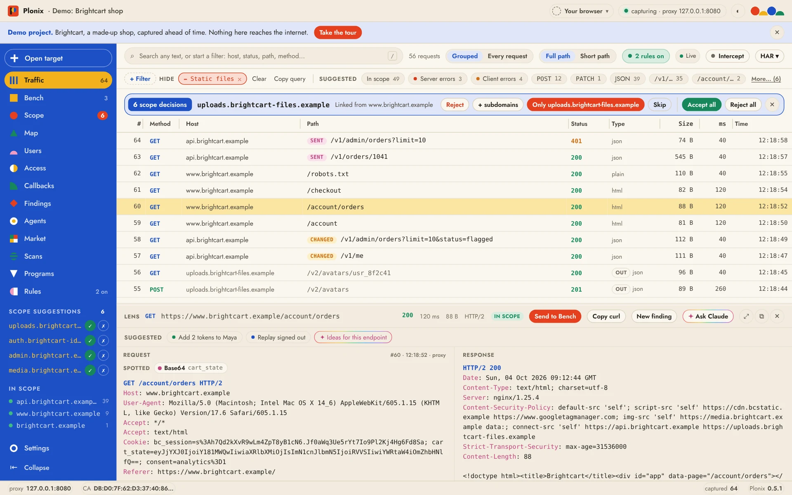

# Getting started

Plonix captures the traffic between your browser and the application you are testing, maps the target as you browse, and helps you experiment and prove what you find. This page takes you from download to captured traffic in about a minute.



## Install

**Mac.** Download [Plonix for Mac](https://github.com/SergeyMalych/plonix/releases/latest/download/Plonix-macOS.dmg) (Apple silicon and Intel, macOS 11 or later), open it and drag Plonix to Applications. Releases are not notarized by Apple yet, so macOS asks before opening Plonix the first time: open it, click **Done**, then go to **System Settings › Privacy & Security** and click **Open Anyway** next to Plonix. Or run `xattr -dr com.apple.quarantine /Applications/Plonix.app` once. [Install and open Plonix](install.md) shows each step with pictures.

**Windows.** Download [Plonix for Windows](https://github.com/SergeyMalych/plonix/releases/latest/download/Plonix-Windows-setup.exe) (64-bit Windows 10 or 11) and run it. The installer is not code-signed yet, so SmartScreen may say it protected your PC: click **More info**, then **Run anyway** ([with pictures](install.md#on-windows)). Plonix keeps its data in `%USERPROFILE%\.plonix`.

Every release is on the [releases page](https://github.com/SergeyMalych/plonix/releases), with what changed in [CHANGELOG.md](../CHANGELOG.md). To build Plonix yourself, see [Build from source](../README.md#build-from-source) in the README.

## Try the demo first

The Start screen opens when you launch Plonix. **Try the Demo** opens a made-up shop's traffic with scope, findings and Bench experiments ready, and offers a short walkthrough. **Test now!** on a stop shows that part of Plonix working for real on the demo's data. Nothing in the demo reaches the internet. See [The demo project](projects.md#the-demo-project).

## Capture your first target

1. On the Start screen, create a project. It is a folder (in `~/Plonix` unless you pick another) that holds everything you capture.
2. Press **Open target** (⌘O, or the button at the top of the sidebar) and type the site you are testing. Plonix opens it in the **capture browser**, a separate browser with its own profile that routes through Plonix and trusts its certificate, so HTTPS works with nothing to install. The domain and its subdomains go into [scope](scope.md).
3. Browse the site. Requests appear in [Traffic](traffic.md) as they happen.

The capture browser is Chrome, Brave, Edge or Chromium. On a Mac with only Safari, Open target offers **Get the Plonix browser**, a one-time download. Firefox works too, after one click to trust the Plonix certificate. See [Setting up capture on any Mac](setup.md).

## From a terminal

The same in one command:

```sh
plonix open example.com
```

It creates the certificate authority (first run only), starts the engine, puts `example.com` and its subdomains in scope, opens a capture browser at the target and opens the Plonix window next to it. **Plonix › Install Command Line Tool…** in the app puts the `plonix` command on your PATH. Every command takes `--json`, and `plonix --help` lists them all.

```sh
plonix search host:example.com status:5xx   # newest first
plonix show 42                              # one request and its response
plonix watch scope:in                       # new traffic as it arrives
```

## Where to go next

- [Traffic and the Lens](traffic.md): search, filter and read what you captured.
- [Scope](scope.md): let scope grow with the evidence, and decide what belongs.
- [The Bench](bench.md): edit a request, send it, branch and compare.
- [Agents and MCP](agents.md): connect Claude Code with `plonix connect claude`.
- [The Plonix window](app.md): shortcuts, appearance and text size.
