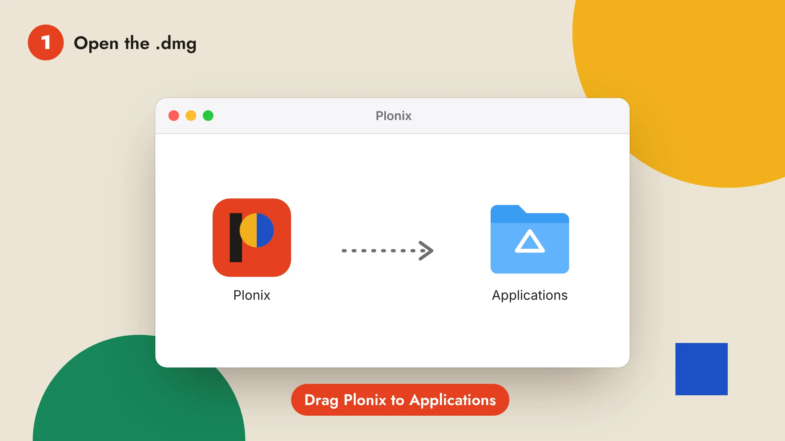
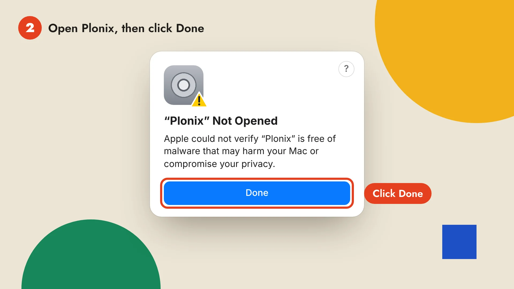
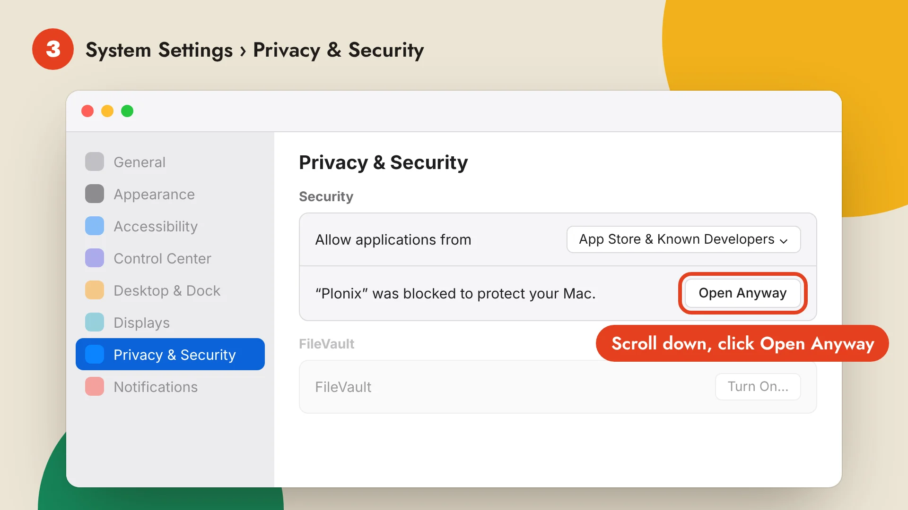
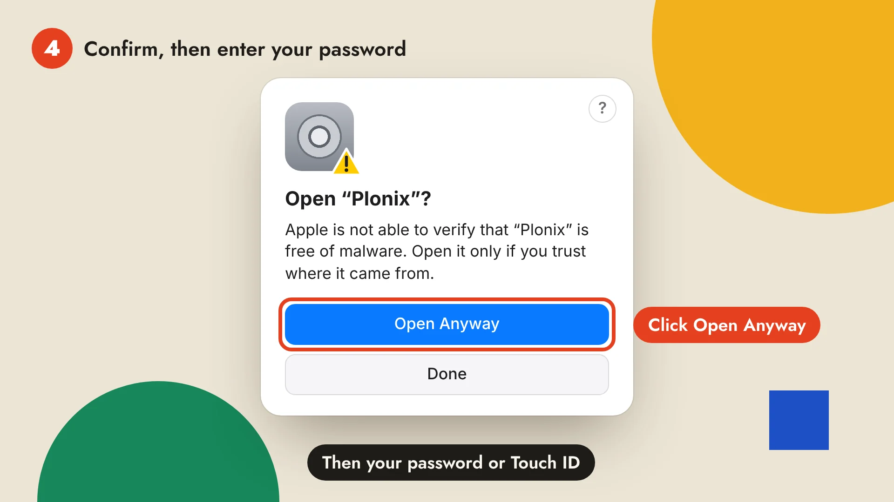
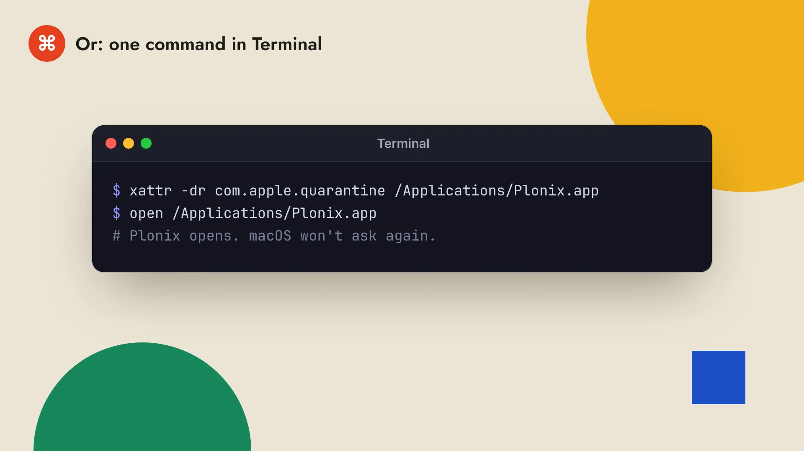
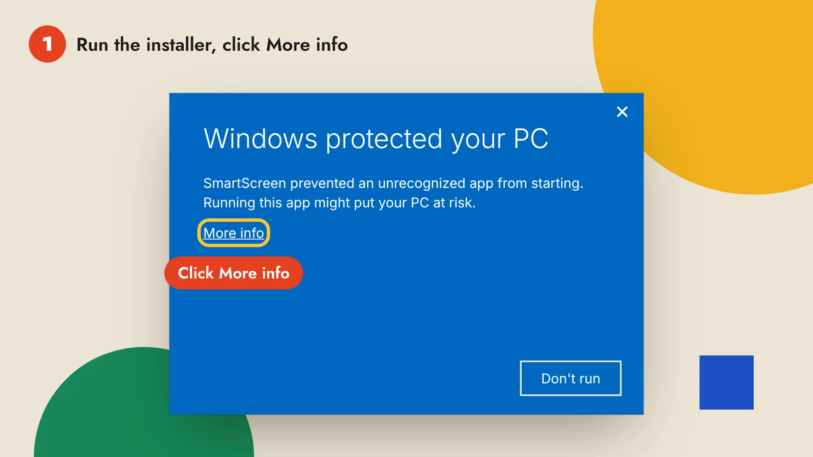
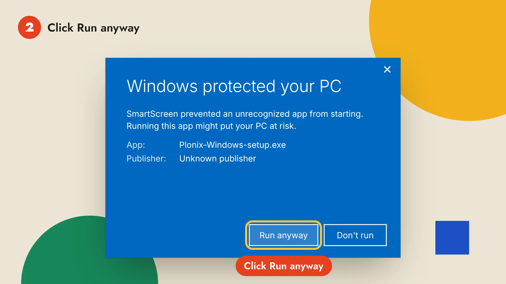

# Install and open Plonix

Plonix is not signed by Apple or Microsoft yet, so the first time you open it, your computer asks whether you trust it. This page shows what you see and what to click, step by step. You only do it once: after that Plonix opens like any other app, updates included.

- [On a Mac](#on-a-mac): macOS 15 Sequoia and later, older macOS, and a one-line Terminal alternative.
- [On Windows](#on-windows): the SmartScreen prompt.
- [If something else goes wrong](#if-something-else-goes-wrong).

## On a Mac

Download [Plonix for Mac](https://github.com/SergeyMalych/plonix/releases/latest/download/Plonix-macOS.dmg). It runs on Apple silicon and Intel Macs with macOS 11 or later.

### 1. Drag Plonix to Applications

Open `Plonix-macOS.dmg` from your Downloads folder and drag Plonix onto the Applications folder.



### 2. Open Plonix, then click Done

Open Plonix from Applications or Launchpad. macOS says **“Plonix” Not Opened** because Apple has not checked the app yet. Click **Done**. Do not move it to the Trash.



### 3. Click Open Anyway in Privacy & Security

Open **System Settings** (Apple menu › System Settings), choose **Privacy & Security** in the sidebar and scroll down to **Security**. Next to **“Plonix” was blocked to protect your Mac**, click **Open Anyway**.



The button shows up only after step 2, and only for about an hour. If you don't see it, open Plonix once more, click Done, and come back.

### 4. Confirm with your password

macOS asks once more. Click **Open Anyway**, then enter your Mac password or use Touch ID. Plonix opens, and from now on it opens with a normal double-click.



### On macOS 14 Sonoma and earlier

You can skip System Settings: in Applications, **right-click** (or Control-click) Plonix, choose **Open**, then click **Open** in the dialog. Steps 2 to 4 above work there too.

### Or: one command in Terminal

If you are comfortable with Terminal, this does all of the above in one go. It tells macOS that you downloaded Plonix on purpose, for this copy of the app only:

```sh
xattr -dr com.apple.quarantine /Applications/Plonix.app
open /Applications/Plonix.app
```



## On Windows

Download [Plonix for Windows](https://github.com/SergeyMalych/plonix/releases/latest/download/Plonix-Windows-setup.exe). It runs on 64-bit Windows 10 and 11.

### 1. Run the installer, then click More info

Open `Plonix-Windows-setup.exe` from your Downloads folder. Windows SmartScreen may say **Windows protected your PC**, because the installer is not code-signed yet. Click **More info**.



### 2. Click Run anyway

The dialog now names the app, `Plonix-Windows-setup.exe`, with an unknown publisher. Click **Run anyway** and the installer starts. Plonix then opens from the Start menu like any other app, and keeps its data in `%USERPROFILE%\.plonix`. The [code signing policy](code-signing.md) says how the installer will be signed.



If your browser holds the download back as uncommon, open the browser's downloads list and choose **Keep**.

## If something else goes wrong

- **“Plonix is damaged and can't be opened”** on a Mac: the app is fine, this is the same check worded differently. Run the [Terminal command](#or-one-command-in-terminal) above.
- **No Open Anyway button:** open Plonix again, click **Done**, and look again in **Privacy & Security** within the hour.
- **Your Mac is managed by an organization:** its settings may not allow apps from outside the App Store. Ask your IT team, or [build Plonix from source](../README.md#build-from-source).
- **Still stuck?** [Open an issue](https://github.com/SergeyMalych/plonix/issues/new/choose) with your macOS or Windows version and what you see.

## Why this happens

Apple and Microsoft show these prompts for apps that are not signed with a paid developer certificate. Plonix is open source and free, and signing for both is on the way (see [Code signing](code-signing.md)). Until then, every release is built in public by GitHub Actions from the code in this repository and published on the [releases page](https://github.com/SergeyMalych/plonix/releases).

Once Plonix opens, head to [Getting started](getting-started.md) to capture your first target.
