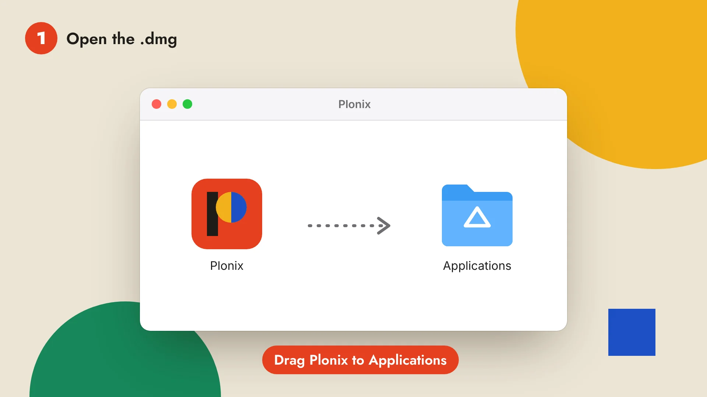
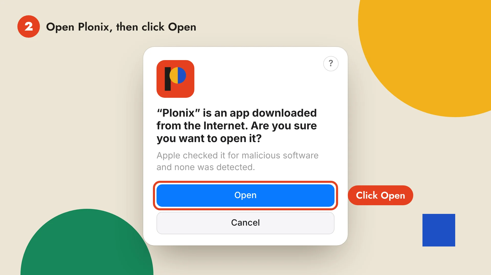
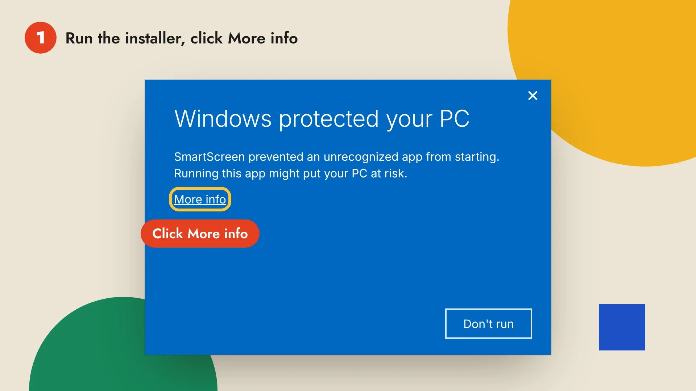
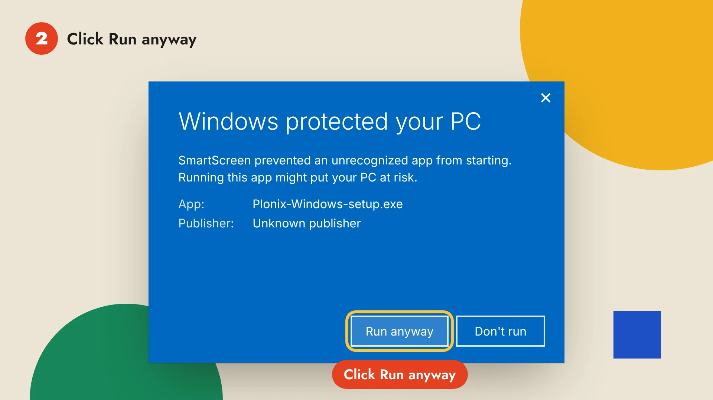

# Install and open Plonix

The Mac app is signed and notarized by Apple, so it opens like any other app you download: macOS asks once whether you want to open it. The Windows installer is not code-signed yet, so the first time Windows asks whether you trust it. This page shows what you see and what to click.

- [On a Mac](#on-a-mac): two steps, and what to do for versions before 0.5.3.
- [On Windows](#on-windows): the SmartScreen prompt.
- [If something else goes wrong](#if-something-else-goes-wrong).

## On a Mac

Download [Plonix for Mac](https://github.com/SergeyMalych/plonix/releases/latest/download/Plonix-macOS.dmg). It runs on Apple silicon and Intel Macs with macOS 11 or later.

### 1. Drag Plonix to Applications

Open `Plonix-macOS.dmg` from your Downloads folder and drag Plonix onto the Applications folder.



### 2. Open Plonix, then click Open

Open Plonix from Applications or Launchpad. macOS says Plonix is an app downloaded from the Internet and that Apple checked it for malicious software. Click **Open**. That's it: from now on Plonix opens with a normal double-click, updates included.



### Versions before 0.5.3

Plonix 0.5.2 and earlier are not notarized, so macOS says **“Plonix” Not Opened**. Click **Done**, open **System Settings › Privacy & Security**, click **Open Anyway** next to Plonix and confirm with your password. Or run this once in Terminal:

```sh
xattr -dr com.apple.quarantine /Applications/Plonix.app
open /Applications/Plonix.app
```

Updating from inside Plonix needs none of this.

## On Windows

Download [Plonix for Windows](https://github.com/SergeyMalych/plonix/releases/latest/download/Plonix-Windows-setup.exe). It runs on 64-bit Windows 10 and 11.

### 1. Run the installer, then click More info

Open `Plonix-Windows-setup.exe` from your Downloads folder. Windows SmartScreen may say **Windows protected your PC**, because the installer is not code-signed yet. Click **More info**.



### 2. Click Run anyway

The dialog now names the app, `Plonix-Windows-setup.exe`, with an unknown publisher. Click **Run anyway** and the installer starts. Plonix then opens from the Start menu like any other app, and keeps its data in `%USERPROFILE%\.plonix`. The [code signing policy](code-signing.md) says how the installer will be signed.



If your browser holds the download back as uncommon, open the browser's downloads list and choose **Keep**.

## If something else goes wrong

- **“Plonix is damaged and can't be opened”** or **“Plonix” Not Opened** on a Mac: you have a version before 0.5.3. Download the [latest version](https://github.com/SergeyMalych/plonix/releases/latest/download/Plonix-macOS.dmg), or see [Versions before 0.5.3](#versions-before-053).
- **Your Mac is managed by an organization:** its settings may not allow apps from outside the App Store. Ask your IT team, or [build Plonix from source](../README.md#build-from-source).
- **Still stuck?** [Open an issue](https://github.com/SergeyMalych/plonix/issues/new/choose) with your macOS or Windows version and what you see.

## Why this happens

Apple and Microsoft show these prompts for apps you download from the web. Plonix for Mac is signed with a Developer ID and notarized by Apple, which checks every release for malicious software before it ships. The Windows installer is not code-signed yet (see [Code signing](code-signing.md)). Every release is built in public by GitHub Actions from the code in this repository and published on the [releases page](https://github.com/SergeyMalych/plonix/releases).

Once Plonix opens, head to [Getting started](getting-started.md) to capture your first target.
