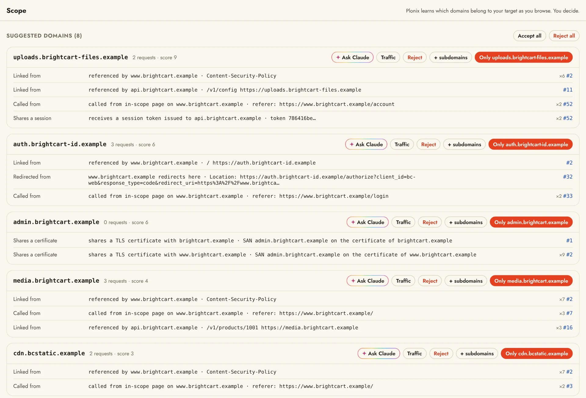

# Scope

Scope is the list of domains you are testing. It decides what Plonix may send to: every request from the Bench, a scan, a crawl or an agent passes one check, and a host that is not accepted is refused. Capture is never limited by scope, so everything you browse is still recorded.



## Adaptive scope

A fixed list assumes you already know every domain an application uses. You find out by using it, so Plonix watches what you browse and suggests domains to bring into scope, each with the evidence that ties it to your target:

| Evidence | Example |
| --- | --- |
| Called from an in-scope page | `Referer` or `Origin` points at an in-scope host |
| Redirect | An in-scope host redirects here (`Location:`) |
| Linked | Referenced in an in-scope page or its `Content-Security-Policy` |
| Shares a session | Receives a session token that an in-scope host issued |
| Shares a certificate | Appears in the TLS certificate names of an in-scope host, or the reverse |

Scope never changes on its own: you accept or reject each suggestion. Accepting a domain looks at past traffic again, so new suggestions surface right away. `*.example.com` covers every subdomain.

## Deciding

Suggestions wait in three places: the Scope screen, the sidebar and a banner in Traffic, each with one-click **Accept** and **Reject**. On the Scope screen:

- **Traffic** on a suggestion shows its requests, to look before you decide.
- **Accept all** and **Reject all** list every suggested domain with a checkbox first, so you can leave some out; unchecked ones stay pending.
- The rule list shows every decision with its note and date. **Remove** forgets a rule, and the domain can be suggested again.
- **Find subdomains** appears once a subdomain finder from the [Market](market.md) is switched on. It asks public sources for subdomains of the domains you accepted and adds them as suggestions to review.

**Open target** adds the target's domain and its subdomains to scope, and following a [program](programs.md) sets scope from the program's assets.

## Third parties

Analytics, ads, payments, CDNs and the like are rarely what you are testing. Scope keeps common third parties out in named groups, so they are never suggested or sent to. A new project starts with every group on and says so once; you switch each group on or off as a set on the Scope screen, and you can create groups of your own.

## What scope changes

- [Traffic](traffic.md) can show only in-scope requests (`scope:in`), and Intercept holds only in-scope hosts by default.
- The [Map](map.md) lists only in-scope hosts.
- The Bench, scans, crawls and Bench runs only reach accepted hosts. When a send is refused, you can accept the host right there.
- **Keep only in-scope traffic** deletes the rest when a project closes. See [Projects](projects.md#keep-only-in-scope-traffic).

## From the terminal

```sh
plonix scope                               # rules, plus suggested domains with evidence
plonix scope review                        # decide on suggestions one by one
plonix scope accept '*.example-cdn.com'    # or: reject, remove
```

Replays to a host that is not accepted are refused with exit code 4 and a hint to accept the host first.
