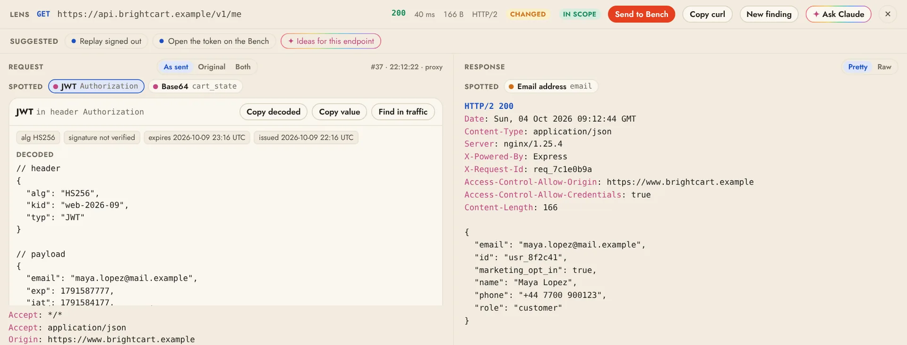

# Traffic and the Lens

**Traffic** lists every request and response that passes through the project's proxy, live. The **Lens** shows the selected one, decoded and pretty-printed. Everything is recorded into the project, in scope or not, so nothing you browsed is lost.



## Search

Type in the search box to narrow the list. Field filters narrow by metadata, and anything else is matched as full text against URLs, headers and decoded bodies. A leading `-` hides what matches instead, and commas match any of several values: `status:4xx,5xx -kind:static`.

```text
host:example.com          host or any subdomain (globs: host:*.cdn.*)
method:POST               HTTP method
status:404  status:5xx    exact code, class, or status:none for no response
path:/api                 path prefix (globs: path:*admin*)
ext:js                    file extension of the path
kind:static               images, fonts, stylesheets, scripts and media
mime:json                 substring of the response content type
scope:in  scope:out       in or out of the current scope
source:proxy              captured traffic; source:replay for sent requests, source:import for HAR imports
is:auth                   a named filter (see Named filters)
"set-cookie: sid"         quoted phrase
passw -logout             plain full-text terms
```

You don't have to remember any of it. As you type, a list under the box offers the fields first, then the values this project actually has (hosts, status codes, paths, content types, named filters), each with how many requests match. ↑↓ picks, Tab completes, Enter adds it. The same search works in `plonix search`, `plonix watch` and the API. Named filters such as `is:graphql` come from [filter packs](filters.md).

## Filter chips

Filters sit as chips above the list, under **Show only** and **Hide**. Add one with **+ Filter**, from the **suggested filters** drawn from your traffic (hide static files, hide the busiest third-party hosts, show only errors), or right-click any row to show only or hide its host, path, status class, content type, extension or method. Click a chip to flip it between show and hide, and × to remove it. **Copy query** gives the same filters as a query for the CLI or the API. Active filters are saved with the project.

## Reading the list

- **Look-alike grouping** folds requests to the same path with different ids into one row. Click a group to see every request in it, or turn grouping off.
- **Repeats** of the same request in a row show as one row with a count (×N). Click it to see each one, or pick **Every request** in the toolbar.
- **Full path or Short path:** the toolbar switches between the whole path and a short one where ids and tokens fold into `{id}` and `{token}` and the query hides behind `?…`, so long URLs stay readable.
- **New domains:** a banner shows each domain [adaptive scope](scope.md) suggests, with its evidence and one-click accept or reject.

## The Lens

The Lens decodes compressed bodies, pretty-prints JSON and lists WebSocket messages under their handshake. Above the request it points out what stands out:

- JWTs (header and payload decoded, algorithm and expiry; the signature is never claimed valid), Base64, hex and double URL-encoding that decode to readable text, and Basic auth credentials;
- personal data (email addresses, card numbers that pass the Luhn check), leaked secrets (cloud, code-hosting, chat and payment keys, private keys) and internal IP addresses;
- stack traces in responses.

Click one to highlight it in place and see the decoded value, then copy it or find it across all captured traffic. Select any text yourself to decode it, find it across traffic or ask Claude about it. Detection runs locally on traffic you already captured; nothing is flagged unless it is there.

**Suggested** in the Lens offers the one next step that fits what is on screen: a response that sets a session offers **Save login as a user**, an id in the path offers **Check this id across users**, a signed-in request offers **Replay signed out**, a reflected value or a redirect opens on the [Bench](bench.md) ready to vary, and an endpoint with inputs offers [Scans](scanning.md) focused on it. When something stands out, the Lens offers to record a [finding](findings.md), and **Ideas for this endpoint** asks Claude what to try. **Copy as curl** works from the Lens, the right-click menu and the Bench. Nothing is sent until you click.

## Intercept

**Intercept** in the Traffic toolbar (or `i`, or `plonix intercept on`) holds requests in the proxy so you can look at each one before it goes on. Held items wait in a panel above the list: edit the request as text and **Forward** it (⌘↵ or `f`), **Drop** it (`d`; the browser gets an error page) or **Forward all**. A count on the button and on Traffic in the sidebar says how many are waiting.

- By default only in-scope hosts are held. **Settings › Intercept** switches to everything, narrows what is held with a Traffic search such as `method:POST path:/api`, and holds **responses** too.
- Nothing waits forever: an unanswered item goes on unchanged after 5 minutes (configurable), and turning Intercept off sends everything held on. Intercept is off whenever a project opens.
- The record shows what was actually sent, marked **edited**, and the Lens shows the original on click.
- WebSocket messages, hosts that are never decrypted and Plonix's own requests (Bench, scans, crawls without a browser) are never held. Agents cannot see or touch the queue.

To change traffic automatically instead of by hand, use [Rules](rules.md).

## Export and import

**HAR ▾** in the toolbar exports all traffic, the filtered view or the rows you pick to a HAR file, and **File › Import HAR…** adds a HAR file's requests to the project. See [HAR files](projects.md#har-files).

## From the terminal

```sh
plonix search host:example.com status:5xx   # newest first
plonix watch scope:in                       # print new traffic as it arrives
plonix show 42                              # one request and its response
plonix intercept on --responses             # hold requests and responses
plonix intercept forward 3 --edit           # edit in $EDITOR, then send on
```
